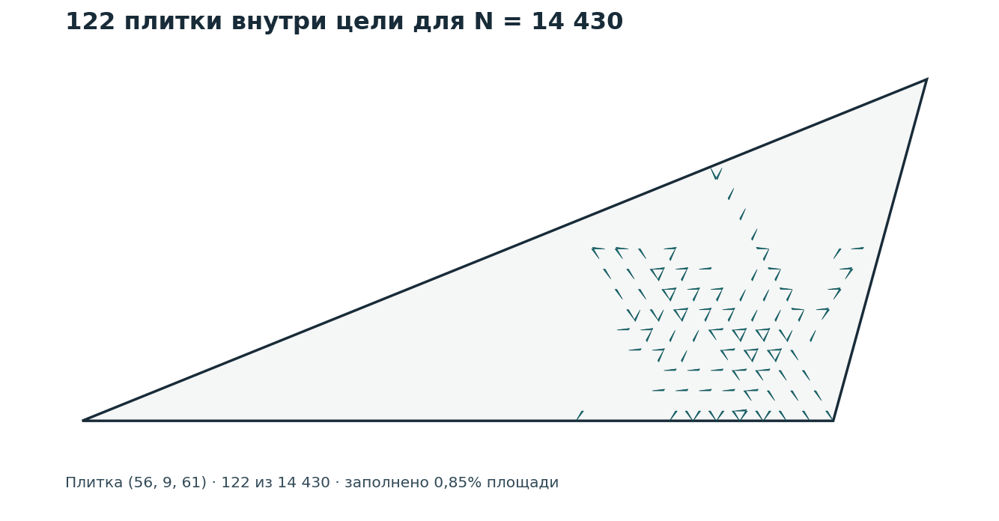

# Erdős №634. Два простых множителя, большой простой делитель и случай 236

18 ноября 2026 года. Пусть $T(N)$ означает, что некоторый невырожденный треугольник можно разделить на $N$ попарно конгруэнтных треугольников. Разрешены отражения и T-соединения. Приведённые ниже выводы опираются на перечисленные геометрические теоремы. Общая классификация остаётся открытой.

## 1. Исходные теоремы

Вне классических чисел (суммы двух квадратов, включая нулевой квадрат, а также $3r^2,6r^2$) всякое разбиение даёт одну из следующих строк с целым положительным масштабом $t$. Все классические числа реализуются. Это следует из классификации Лацковича, рациональности Beeson–Zhang и условий на масштаб в работе Paliy. Числа из разных строк могут совпадать. [Постановка](https://www.erdosproblems.com/634), [Paliy, §§1–5, с первичными источниками](https://github.com/DenisUkranian/erdos-634-tilings/blob/0f7935b71fd958bd764bccf079e1e70bc68ce351/research/uniform-reduction/PROOF.md).

| Параметры | Возможные коэффициенты $N/t^2$ |
|---|---|
| $0<u<v,\ \gcd(u,v)=1,\ b=v^2-u^2,\ Q=b+v^2,\ P=b+2v^2$ | $Q$ (W), $P$ (β), $b$ (θ), $bQ$ (α), $QP$ (конструкция Paliy) |
| Двойной угол, те же $u,v,b$, дополнительно $v<2u$ | $b$ |
| Примитивные $a,b>0,\ c^2=a^2-ab+b^2$ | $ab$ для равносторонней цели |
| Примитивные $a,b>0,\ c^2=a^2+ab+b^2$ | $ab,\ b(a+b),\ b(a+2b),\ (a+2b)(2a+b),\ 3(a+b)(a+2b),\ (a+b)(2a+b)$ |

Для W и β используем геометрическое исключение $t=1$ из исправленной работы Beeson–Roșu. Для θ и двойного угла ограничение $t\ge2$ дано в указанном сведении. Для строки $QP$ Paliy построил разбиения при любом $t\ge1$. Для остальных строк одно равенство для числа плиток обычно даёт лишь необходимое условие. [Beeson–Roșu, v4](https://arxiv.org/abs/2607.23453v4), [первичная конструкция Paliy](https://github.com/DenisUkranian/erdos-634-tilings/blob/0f7935b71fd958bd764bccf079e1e70bc68ce351/docs/two-piece-construction.md), [Beeson, v6, §§11.3 и 11.6](https://arxiv.org/html/1206.2229v6#S11).

## 2. Два разных нечётных простых

Пусть $p<q$ — разные нечётные простые. Число $pq$ квадратсвободно, поэтому $t=1$. Классическое разбиение возможно ровно при $p\equiv q\equiv1\pmod4$. После исключения W, β, θ и двойного угла остаются следующие возможности.

| Строка | Эквивалентное условие для её арифметики при $N=pq$ | Реализация |
|---|---|---|
| α | $4q=p^2+6p+1$ | Необходимое условие |
| Paliy | $3p<2q<4p$, числа $q-p$ и $2q-3p$ — квадраты | Необходимо и достаточно |
| Равносторонняя цель | Только $(p,q)=(3,5)$ в строке с плюс-нормой | Невозможность подтверждена сертификатом для 15 |
| Равнобедренная цель, угол плитки $120^\circ$ | $q>2p$ и $4q=3p^2+6p-1$ либо $4q=p^2+6p-3$ | Необходимое условие |
| F2 | $q<2p$, сумма $p+q$ кратна 3, $(p^2-pq+q^2)/3$ — квадрат целого числа | Достаточно в указанном ниже конусе и при известном условии вложенной конструкции |
| F1, F3, F4 и равносторонняя цель с минус-нормой | Ни одной пары | Исключены арифметически |

**Вывод.** Для α меньший множитель $b=(v-u)(v+u)=p$, поэтому $v=(p+1)/2,\ u=(p-1)/2$. Тогда $q=p+v^2>2p$. Нечётность $q$ требует $p\equiv q\equiv3\pmod4$. Для строки Paliy равенства $p=2v^2-u^2,\ q=3v^2-u^2$ дают указанные два квадрата. Обратно, неравенства обеспечивают $0<u<v$, а простота $p$ обеспечивает взаимную простоту. Разность $q-p=v^2$ чётна, поэтому $v$ чётно, $u$ нечётно и оба простых сравнимы с 3 по модулю 4.

Для равносторонней цели из $ab=pq$ получаются пары $\{1,pq\}$ и $\{p,q\}$. В первой $x^2\pm x+1$ лежит между соседними квадратами при $x>1$. Во второй положим $Z=2q\pm p$ по знаку нормы. Тогда $(2c-Z)(2c+Z)=3p^2$. Меньший делитель $d<\sqrt{3}\,p$ равен $1,3$ или $p$. При $d=p$ получается $q\le p$. При $d=1,3$ для плюс-нормы получаем $(p-1)(3p+1)/4,\ (p-3)(p+1)/4$, для минус-нормы $(p+1)(3p-1)/4,\ (p-1)(p+3)/4$. Каждое число есть произведение соответствующих половин. При $p\ge5$ оно составное или не больше $p$. Для $p=3$ остаётся только $q=5,\ c=7$.

В плюс-норме $r=a+b$ не может быть нечётным простым. Иначе при $Z=|a-b|$ имеем $(2c-Z)(2c+Z)=3r^2$, где меньший делитель строго больше $r$, поскольку $c>\max(a,b)$, и не больше $\sqrt{3}\,r$. В этом промежутке нет делителя $3r^2$, в том числе при $r=3$. Это исключает F4 и F1, поскольку $b=1$ в F1 потребовало бы квадрата $a^2+a+1$. F3 имеет не менее трёх простых множителей с кратностями.

В равнобедренной строке с углом $120^\circ$ аналогично $b=p,\ a=q-2p>0$. Положим $Z=2a+p=2q-3p>p$ в той же факторизации $3p^2$. Делители 1 и 3 дают указанные две формулы, а $p$ дал бы $Z=p$. Обратно формулы и неравенство дают целый $c=(d+3p^2/d)/4$ при $d=1,3$. Если $p\equiv3\pmod4$, только первая формула даёт нечётное $q$, причём $q-p=(3p-1)(p+1)/4\equiv0\pmod4$. Если $p\equiv1\pmod4$, нечётное $q$ даёт вторая и $q-p=(p-1)(p+3)/4\equiv0\pmod4$.

В F2 выберем $a>b$. Тогда $p=a+2b,\ q=2a+b$, откуда $a=(2q-p)/3,\ b=(2p-q)/3$ и $c^2=(p^2-pq+q^2)/3$. Эти формулы обратимы при выписанных условиях, а всякий общий делитель $a,b$ делил бы $p,q$. Оба параметра нечётны, поэтому $ab\equiv7\pmod8$ следует из плюс-нормы. Отсюда $pq=2a^2+5ab+2b^2\equiv7\pmod8$. Простые имеют разные остатки по модулю 4.

**Точные следствия без ограничения сверху на $N$.**

1. Если $p\equiv q\equiv3\pmod4,\ q<2p$, то $T(pq)$ эквивалентно тому, что $q-p$ и $2q-3p$ — **положительные** полные квадраты. Например, $7\cdot11=77$ даёт квадраты 4 и 1.
2. Если у $p,q$ разные остатки по модулю 4 и $q>2p$, то $T(pq)$ ложно. При $q<2p$ для смешанных остатков остаётся только F2, кроме уже исключённого случая 15. Если $109q<122p$, её арифметическое условие также достаточно. Подстановка даёт $1<a/b<45/32$, где действует конструкция вложенных углов Paliy. В этом конусе получен точный критерий для всех пар. [Достаточность и граница конуса](https://github.com/DenisUkranian/erdos-634-tilings/blob/0f7935b71fd958bd764bccf079e1e70bc68ce351/research/global-criterion-oct7/SHARP_NESTED_CONE.md).
3. Для любого простого $q$ верны
$$
 T(5q)\iff q=2\ \text{или}\ q\equiv1\pmod4,\qquad
 T(13q)\iff q\in\{2,11\}\ \text{или}\ q\equiv1\pmod4 .
$$
Для 5 остаются малые смешанные пары с 3 и 7. Первая даёт 15, вторая дала бы F2 с $(a,b)=(3,1)$ и $c^2=13$. Для 13 проверяются 3, 7, 11, 19, 23. Пара с 3 исключается неравенством $13>2\cdot3$, пары с 7 и 19 не проходят делимость на 3, пара с 23 дала бы $(11,1)$ и $c^2=133$. Случай $11\cdot13=143$ реализует известное разбиение Гердта плиткой $(5,3,7)$. Равные простые дают квадраты. Случаи с 2 дают суммы двух квадратов. [Разбиение на 143](https://github.com/ElVec1o/erdos634_primes_and_N200/blob/752005605ca4e607d2a08f57bdc2445dd5558dbb/paper/tiling143.pdf).
4. Предыдущая записка и сертификаты в этом пакете дают $\neg T(3q)$ при простом $q>3$. Для $7q$ данный разбор вместе с известными исключениями 14 и 161 оставляет единственный нерешённый здесь случай $q=47$. При $q=7,11$ ответ положительный, при остальных простых $q\ne47$ отрицательный. Действительно, для $q>14$ две нечётные квадратичные возможности дают лишь 23 и 47. Для 329 единственная оставшаяся цель имеет стороны $(259,259,329)$, плитка $(33,7,37)$. [Bonfioli, классификация до 200](https://github.com/ElVec1o/erdos634_primes_and_N200/blob/752005605ca4e607d2a08f57bdc2445dd5558dbb/README.md).

## 3. Большой простой делитель при произвольном втором множителе

Пусть $h\ge2$ — целое, $q\ge5$ — простое, а $4q>3h^2+6h-1$. Если $h$ квадратсвободно **или** $q\equiv5,19\pmod{24}$, то
$$
 T(hq)\quad\Longleftrightarrow\quad hq=x^2+y^2
 \quad\text{для некоторых целых }x,y.
$$
В частности, при $q\equiv19\pmod{24}$ разбиение невозможно для любого такого $h$. При $q\equiv5\pmod{24}$ оно существует ровно тогда, когда само $h$ представимо суммой двух квадратов. Для фиксированного квадратсвободного $h$ это решает все простые $q$ выше явной границы.

**Доказательство.** Положим $B(h)=(3h^2+6h-1)/4$. Поскольку $q>B(h)>h$, имеем $q\nmid h$. В любой строке §1 масштаб удовлетворяет $t^2\mid h$. Числа $k=h/t^2$ и $q$ взаимно просты. Если $kq$ раскладывается в два целых множителя $>1$, множитель, содержащий $q$, не меньше $q$, а второй делит $k$ и не больше $k$. Это исключает $QP$, F2 и F4, поскольку в каждой строке отношение большего множителя к меньшему строго меньше 2 и $2k<q$. Для F3 сначала делим на 3, которое делит $k$, затем применяем то же неравенство к $a+b,\ a+2b$.

В строке α получаем $b\le k,\ Q\ge q$. Из $b=(v-u)(v+u)\ge2v-1$ следует
$$Q=b+v^2\le(k^2+6k+1)/4\le B(k)\le B(h).$$
Для равносторонних целей положим $m=\min(a,b),\ A=\max(a,b)$. Тогда $m\le k,\ A\ge q$. При $Z=2A\pm m$ верно $(2c-Z)(2c+Z)=3m^2$. Меньший множитель положителен и не меньше 1. Вычитая множители, получаем $2Z\le3m^2-1$ и $A\le(3m^2+2m-1)/4<q$. Тот же вывод действует и при меньшем множителе 1. В F1 и равнобедренной плюс-строке $b\le k$, больший множитель не больше $a+2b$. Из той же факторизации с $Z=2a+b$ следует $a+2b\le(3b^2+6b-1)/4\le B(h)$.

Для строк θ и двойного угла $b=kq=(v-u)(v+u)$. Меньший множитель не больше $k$, больший не меньше $q$, в том числе когда $v-u=1$. По геометрическим неравенствам Paliy $u^2\le tb$ в обеих строках (в θ верно даже $uv\le tb$). Поэтому
$$
 (q-k)^2\le 4t kq,\qquad
 q/k\le 2t+1+2\sqrt{t^2+t}<4t+2 .
$$
При $t\ge2$ отсюда $q<(4/t+2/t^2)h\le5h/2\le B(h)$ для $h\ge2$. [Paliy, доказательство геометрических неравенств с учётом T-соединений](https://github.com/DenisUkranian/erdos-634-tilings/blob/0f7935b71fd958bd764bccf079e1e70bc68ce351/docs/long-seams-density.md).

Остаются W и β. Им требуется $t\ge2$, что невозможно для квадратсвободного $h$. Для любой из них $Dv^2-u^2=kq$ при $D=2$ либо 3. Простое $q$ не делит $v$, иначе оно делило бы $u$. Следовательно, $D$ — квадратичный вычет по модулю $q$. Для $q\equiv5,19\pmod{24}$ оба числа 2 и 3 — невычеты, что исключает эти две строки. В классическом списке $3r^2$ и $6r^2$ невозможны, поскольку $q>3$ входит в $hq$ ровно один раз. Остаются ровно суммы двух квадратов. Частные утверждения следуют из критерия суммы двух квадратов по показателям простых $3\bmod4$.

## 4. Квадратсвободная часть в совокупности

Обозначим через $S_{\rm sf}(X)$ количество квадратсвободных $N\le X$ с $T(N)$, через $C(X)$ — количество квадратсвободных сумм двух квадратов. Тогда
$$
 0\le S_{\rm sf}(X)-C(X)=O(\sqrt X),\qquad
 S_{\rm sf}(X)\sim\frac{K}{\zeta(2)}\,\frac{X}{\sqrt{\log X}},
 \quad K/\zeta(2)\simeq0.4645922709,
$$
где $K$ — постоянная Ландау–Рамануджана. Это оценка количества чисел. Она допускает бесконечное множество индивидуальных исключений из критерия суммы двух квадратов.

Действительно, $t=1$ устраняет W, β, θ и двойной угол. По леммам 5.1–5.2 Paliy в девяти оставшихся строках (две параметрические и семь норменных) количество примитивных наборов параметров с коэффициентом $\le X$ есть $O(\sqrt X)$. Два отдельных классических семейства для квадратсвободных дают не более 3 и 6. Результат о разреженности этих девяти строк принадлежит Paliy. [Paliy, леммы 5.1–5.2](https://github.com/DenisUkranian/erdos-634-tilings/blob/0f7935b71fd958bd764bccf079e1e70bc68ce351/research/uniform-sectors/PROOF.md).

Пусть $B_2(X)$ считает все суммы двух квадратов, включая квадраты. Умножение на квадрат и деление на квадратный делитель сохраняют это свойство. Поэтому
$$ C(X)=\sum_{d\le\sqrt X}\mu(d)\,B_2(X/d^2). $$
Для фиксированного $d$ теорема Ландау даёт вклад в главную константу $K\mu(d)/d^2$. При $d\le X^{1/4}$ нормированные члены ограничены константой, умноженной на $1/d^2$, поскольку $\log(X/d^2)\ge\frac12\log X$. Остальной хвост оценивается сверху через $\sum_{d>X^{1/4}}X/d^2=O(X^{3/4})$. Это обосновывает переход к пределу и константу $K\sum_{d\ge1}\mu(d)/d^2=K/\zeta(2)$. [D. Shanks, *The Second-Order Term in the Asymptotic Expansion of B(x)*](https://doi.org/10.2307/2003407).

## 5. Масштаб два и числа $4p$

Во всей W-строке при масштабе два существует ровно одна примитивная пара $(u,v)=(1,2)$. Действительно, $2u<v$ запрещено граничной теоремой (следствие 1.9(a)). При $u\ge2,\ v<2u$ выполняются обе гипотезы теоремы Bonfioli о W-gap, $v\le2u$ и $2(v-u)<v$. Равенство $v=2u$ при взаимной простоте даёт $(1,2)$, где известна конструкция на 28 плиток. При $u=1$ других случаев не осталось. [Bonfioli, следствие 1.9](https://github.com/ElVec1o/erdos634_primes_and_N200/blob/752005605ca4e607d2a08f57bdc2445dd5558dbb/README.md), [теорема W-gap](https://github.com/ElVec1o/erdos634_primes_and_N200/blob/752005605ca4e607d2a08f57bdc2445dd5558dbb/paper/erdos634_v6_main.tex), [Beeson, §10.4](https://arxiv.org/html/1206.2229v6#S10.SS4).

Пусть теперь $N=4p$ для простого $p>3$. Только $t=1,2$ возможны. При $t=1$ четыре строки исключены масштабом, а коэффициенты всех девяти остальных строк никогда не равны $4\bmod8$ по прямой подстановке остатков в §5 исходного сведения. При $t=2$ коэффициент равен простому $p$. Произведения с двумя множителями $>1$ отпадают. Значение 1 у одного из параметров в равносторонней норме или $b=1$ в F1/равнобедренной норме потребовало бы квадрата $x^2\pm x+1$ с $x>1$ или квадрата $a^2+a+1$. Для θ и двойного угла $v-u=1,\ u=(p-1)/2\ge2$. Первую исключает предложение 6.4(ii) Bonfioli с $k=u$. Для второй теорема F применима, поскольку $(t-1)(v-u)=1<u$. [Bonfioli, предложение 6.4](https://github.com/ElVec1o/erdos634_primes_and_N200/blob/752005605ca4e607d2a08f57bdc2445dd5558dbb/README.md), [теорема F и её условия](https://github.com/ElVec1o/erdos634_primes_and_N200/blob/752005605ca4e607d2a08f57bdc2445dd5558dbb/paper/erdos634_primes_and_N200.tex).

Значит, при $p\equiv1\pmod4$ работает классическая конструкция. При $p\equiv7\pmod{12}$ ответ положителен **ровно для $p=7$**, то есть для $N=28$. Действительно, единственная возможная W-строка уже разобрана, а в β-строке $p=3v^2-u^2$ требует $p\equiv11\pmod{12}$, поскольку нечётное значение сравнимо с 3 по модулю 4 и с 2 по модулю 3. Простые 2 и 3 дают классические 8 и 12.

При $p\equiv11\pmod{12}$ остаётся только β при $t=2$. Пара $(u,v)$, если существует, единственна. Для двух пар $(u,v),(U,V)$ простое $p$ делит $(uV-Uv)(uV+Uv)$. Но $v^2,V^2<p/2$ и $0<uV+Uv<2vV<p$. Тогда $uV-Uv=0$, и примитивность отождествляет пары. Из единственности не следует реализуемость цели.

В оставшейся β-строке необходима также оценка $4u\ge v$ по следствию 1.9(b) при $t=2$. Например, для $p=11$ существует разбиение на 44, для $p=23$ пара $(2,3)$ исключена отдельным предложением 7.2. Для $p=59$ указанное ограничение оставляет $(4,5)$.

Есть следствие и для §3. Если $h=4s$ с квадратсвободным $s$, то $t=1$ или 2. При $q>B(h)$ разбиение W при $t=2$ не подходит, поскольку единственное такое число равно 28. В β необходимо, чтобы 3 было квадратичным вычетом по модулю $q$. Поэтому при $q\equiv5,7\pmod{12}$ критерий сумм двух квадратов из §3 верен для всех таких $h$, включая случаи, когда 2 является квадратичным вычетом.

## 6. Геометрическая проверка для 236

При $N=4\cdot59$ единственная геометрическая задача после исключений §5 — β-треугольник $(250,250,472)$ с плиткой $(20,9,25)$. До применения геометрии арифметика допускает также θ и двойной угол с $u=29,\ v=30$. Для обоих уже $tb=2\cdot59=118<29^2$, что даёт отдельное исключение по §3. У оставшейся β-цели углы $(\beta,\beta,3\alpha)$, а $3\alpha+2\beta=\pi$.

**Проверяемая лемма о боковой стороне.** При $t=2,\ u=f-1,\ v=f,\ f\ge3$ на каждой равной стороне цели β должно быть не менее $f$ последовательных рёбер длины $c=f^2$, с углом $\alpha$ у одного и того же конца каждого ребра. По предложению 7.3 Bonfioli другой допустимый тип цепочки требует $u+1\le k\le f-1$, что при $u=f-1$ невозможно. На основании, соединяющем вершины β, тот же вывод даёт теорема 1.8. Длинная цепочка может начинаться с отступом от вершины. В проверке не использовалось предположение о нулевом отступе. [Нумерация в первоисточнике](https://github.com/ElVec1o/erdos634_primes_and_N200/blob/752005605ca4e607d2a08f57bdc2445dd5558dbb/README.md), [декларация о боковой стороне](https://github.com/ElVec1o/erdos634_primes_and_N200/blob/752005605ca4e607d2a08f57bdc2445dd5558dbb/lean/Erdos634/Draft/SideRunGCornerMainB.lean).

Если $x,y,z$ — количества рёбер длины $f(f-1),\,2f-1,\,f^2$ на боковой стороне, то
$$2f^3=xf(f-1)+y(2f-1)+zf^2,\qquad z\ge f.$$
По модулю $f$ имеем $y=fm$. Деление на $f$ даёт $x=rf-m$ и $z=2f-r(f-1)-m$. Так как $r,m\ge0$ и $r(f-1)+m\le f$, при $f\ge3$ остаются ровно три набора $(0,0,2f)$, $(f,0,f+1)$, $(f-1,f,f)$. Для $f=5$ это $(0,0,10),(5,0,6),(4,5,5)$. На основании длины 472 остаются 15 целочисленных наборов, они приведены в файле fixed_cases_result.json.

**Совместимость границ.** В точных координатах $(x,y\sqrt{21})$ цель имеет вершины $(0,0),(472,0),(236,18)$. На каждом внешнем отрезке перечислены все возможные целые граничные рёбра с двумя способами расположить плитку. Суммы углов в любом прямом стыке имеют тип $3\alpha+2\beta$ или $\alpha+\beta+\gamma$. Для каждой пары соседних граничных плиток проверялось, допускают ли они веер плиток в оставшемся угле. Однотипная цепочка из пяти рёбер $c$ отслеживалась при подсчёте последовательностей. Для вершин β необходима одна плитка с углом β, для вершины $3\alpha$ — три угла α. Это следует приравниванием рациональной и иррациональной частей в угловом уравнении.

* Для каждой боковой стороны осталось 249 слов, для основания — 932 966 972 041. У каждого из 249 боковых слов все стыки и вершину можно заполнить **одновременно** согласованными плитками первого ряда. Это проверено отдельным перебором collar236.json.
* С учётом отражения, которое переставляет две боковые стороны, имеется 31 125 неупорядоченных пар слов. Для них проверено 62 250 совместимых размещений боковых плиток и плиток вершины. Для каждого существует слово основания, чьи отдельные граничные плитки совместимы с этим размещением. У симметричной пары боковых слов некоторые размещения вершины могут дополнительно отождествляться отражением.
* Условия на слова основания проверяют существование совместимой плитки в каждой позиции и локальное заполнение в отдельно взятом стыке. Они не требуют согласованности всех внутренних плиток разных стыков основания. Все полученные числа относятся к граничным проверкам.
* В положительном контроле с **той же** плиткой и коэффициентом масштаба 5 собраны 1475 плиток, цель имеет стороны $(625,625,1180)$. Независимый скрипт развернул сетки в отдельные треугольники, сверил длины, включение, общую площадь и все 1 087 075 пар на перекрытие внутренних областей. Длины максимальных однотипных цепочек на двух боковых сторонах и основании — 25, 25 и 20. Геометрическая конструкция для масштаба $v$ принадлежит Beeson, координатный генератор взят у Paliy. Дополнительно проверены девять плиток, найденных поиском для трёхкратно увеличенной копии плитки, и отрицательный контроль с одной дублированной плиткой. [Конструкции W/β и источники](https://github.com/DenisUkranian/erdos-634-tilings/blob/0f7935b71fd958bd764bccf079e1e70bc68ce351/research/updates-2026-10-10/w-beta/UNRESTRICTED_CONSTRUCTION.md).

Проверка внешних сторон носит целочисленный характер. На каждом максимальном прямом внутреннем шве вся его длина покрыта с каждой стороны последовательностью целых рёбер. Отсчёт от одного общего конца даёт целую длину каждой части между вершинами. Внешняя сторона также состоит из целых рёбер. В поиске допускаются попадания вершин во внутренность ребра. Поиск с ограничением на ориентации прерывается, если это ограничение достигнуто. Отрицательный машинный вывод для всего 236 потребовал бы полного дерева либо проверяемого эквивалентного сертификата.

Проверен также конструктивный путь. В 14 конкретных разбиениях W и β той же плиткой, при масштабах 5, 9, 10, 13, 14, 15 и 17, перебраны все треугольные подцели β масштабов 1–5, стороны которых целиком проходят по имеющимся рёбрам. В этих разбиениях суммарно 100 905 плиток. Найдена контрольная цель масштаба 5 в её исходном разбиении. Ни одной подцели масштабов 1–4 не найдено. Это исключает извлечение 236 плиток таким способом из этих конкретных размещений. Поиск проверяет наличие всех трёх непрерывных сторон и двух возможных положений вершины относительно основания. Подробности для каждого размещения даны в embedded_targets_result.json.

## 7. Контроль для 14 430

$14430=2\cdot3\cdot5\cdot13\cdot37$ квадратсвободно. Список нерешённых **неквадратсвободных** чисел Bonfioli не относится к этому примеру. Перебор всех строк §1 даёт только F3, $(a,b,c)=(56,9,61)$, $3(a+b)(a+2b)=3\cdot65\cdot74=14430$. Цель $(c^2,c(a+2b),3b(a+b))=(3721,4514,1755)$. Параметры также восстанавливаются перебором делителей $14430/3=(a+b)(a+2b)$.

Критерий Paliy, давший разбиение на 4830, требует $b^2+2ab-a^2=q'c+Aa+Bb$ при $q'>0,\ A,B\ge0$. Для $(56,9,61)$ левая часть равна $-2047$. Поэтому эта конструкция неприменима. Оставшийся вопрос — существует ли другая геометрическая конструкция либо препятствие для **всех** конструкций этой единственной цели. [Paliy, конструкция для 4830](https://github.com/DenisUkranian/erdos-634-tilings/blob/0f7935b71fd958bd764bccf079e1e70bc68ce351/research/universal-closure-oct8/f3-general/MIXED_CORNER_THEOREM.md), [Paliy, ограничения для 14430](https://github.com/DenisUkranian/erdos-634-tilings/blob/0f7935b71fd958bd764bccf079e1e70bc68ce351/research/updates-2026-10-10/f3-14430/NO_61_HEIGHT.md).

### Что можно проверить на 122 плитках

В первичном исследовании Paliy показано, что на обычной высоте $h\ne2$ число плиток $n_h$ кратно 61 и не может равняться 61. Под «высотой» здесь понимается класс направлений коротких рёбер. Для однознакового слоя на каждой несущей прямой количества рёбер $m,n$ длин 56 и 9 удовлетворяют $56m-9n\equiv0\pmod{61}$. Проверено, насколько далеко можно продвинуться с этим ограничением.

Построено конкретное размещение **122 попарно неперекрывающихся плиток** $(56,9,61)$ в точной цели $(3721,4514,1755)$. Все плитки имеют одну обычную короткую высоту $h=0$ и один знак характера $+47$. Использованы 26 прямых. На 24 из них пары чисел рёбер равны $(5,4)$, на двух — $(1,13)$. Действительно, $56\cdot5-9\cdot4=244=4\cdot61$ и $56-9\cdot13=-61$. По всем прямым получается ровно по 122 ребра каждой длины. Размещение проверено по координатам для каждой плитки и каждой из 7381 пары. Покрыто $122/14430$ площади цели.

Такой пример исключает попытку вывести $n_h\ne122$ **только** из перечисленных индивидуальных сравнений на прямых, общего знака, включения в цель и непересечения плиток этого слоя. Задача о дополнении оставшейся области плитками, связности контактов и согласовании с соседними высотами сохраняется. Координаты находятся в f3_layer122.json, независимый от их построения скрипт — в f3_layer_check.py. Рисунок построен по тем же координатам.

## 8. Результаты проверок и область применимости

| Проверка | Полученный результат |
|---|---|
| Все $N=pq\le10^6$ для разных нечётных простых $p,q$ | 168 330 чисел, ноль расхождений между формулами §2 и прямым перечислением строк §1 |
| Те же 168 330 чисел с указанными достаточными и необходимыми теоремами | 34 456 положительных, 133 847 отрицательных, 27 остаются без решения этими критериями. Все 27 с параметрами приведены в arithmetic_result.json |
| Пары $(h,q)$ с $hq\le10^6$, $h\ge2$, $q>B(h)$ | 380 394 пары. Из них 287 777 удовлетворяют основному достаточному условию применимости эквивалентности §3, в том числе 31 029 с неквадратсвободным $h$. Ноль противоречащих арифметических представлений |
| Разбиения Paliy, используемые как положительный контроль | При $(u,v)=(1,2),(2,3),(3,4)$ формула даёт 77, 322, 897. Для 322 слагаемые конструкции равны 126 и 196 |
| Фиксированная положительная проверка на 1475 | Полное покрытие доказано проверкой координат, знаков и всех пар. Перебор по графу его рёбер дал 834 вершины, 2308 участков и 1475 независимых циклов |

Для арифметического перебора §2 границы параметров следуют из $bQ,\ QP>v^3$, а каждый норменный коэффициент не меньше $ab$. Для каждого $m=\min(a,b)$ достаточно $m\le\sqrt X$ и $\max(a,b)\le X/m$. В §3 дополнительно перебирались все квадратные масштабы для произведений, W и β, а также все возможные разложения разности квадратов для каждой пары $(h,q)$. Таким образом, конечные тесты используют другой способ вычислить предсказанные множества. Доказательства для неограниченных параметров приведены в §§2–5. Число 27 относится только к перечисленным тестам. В двух положительных реестрах Bonfioli версий 5.0 и 6.0 нет строк с этими 27 значениями в поле N. Это не исчерпывающий обзор литературы.

**Поиск 236.** Первая ускоренная реализация посетила 5 864 449 состояний, вариант с цепочками — 6 656 641, вариант с запоминанием — 6 567 553, вариант с проверкой слов всех сторон — 3 918 849. Все четыре остановились по времени. В разных запусках были общие состояния. Максимальная достигнутая глубина 214 соответствует частичной конфигурации и не свидетельствует о возможности продолжения. При разбиении поиска по 62 250 начальным конфигурациям выполнены следующие отдельные запуски.

| Лимит на начальную конфигурацию | Обработано конфигураций | Исчерпано программой | Осталось после лимита |
|---|---:|---:|---:|
| 12 узлов, для всех | 62 250 | 24 588 | 37 662 |
| 96 узлов, с дополнительными инвариантами, для всех | 62 250 | 27 522 | 34 728 |
| 3000 узлов, отдельный запуск по порядку | 2113 полностью обработанных бюджетов | 943 | 1170 дошли до лимита, остальные 60 137 составляют непроверенный или прерванный остаток |

Результаты разных строк нельзя складывать. Списки идентификаторов первых двух проходов приложены. Для задач, которые алгоритм пометил исчерпанными, отдельные независимо воспроизводимые деревья опровержения не создавались. Это журнал исследования. Полного сертификата для 236 нет.

В усиленном поиске каждая ориентированная сторона записана направлением $k\gamma+j\pi$. На каждой плитке сумма длин со знаками $(-1)^j$ равна $\pm14$, а со знаками $(-1)^{k+j}$ равна $\pm54$. Это проверяется для одной плитки с рёбрами $25,20,9$ в классах $0,3,2$ и сохраняется по модулю знака при повороте и отражении. На каждом замкнутом контуре вдоль рёбер в завершённом разбиении площадь в единицах площади плитки и суммы в единицах 14 и 54 — целые числа одной чётности. Для простого контура это сложение вкладов всех заключённых в нём плиток. Для произвольного обхода применяются целые числа обходов отдельных граней. Учтены также доступное число углов каждого типа и оценки возможных вкладов классов $k$ по модулям от 2 до 6. Скрипт edge_invariants.py проверяет ограничения на всех циклах полного положительного контроля и на 1535 наборах плиток.

## 9. Вклад, воспроизведение и оставшийся шаг

Конструкция для $j^2(b+c)(b+2c)$, в частности для 322 и 897, — исходный результат Denis Paliy. Beeson изложил и атрибутировал эти результаты в §§11.3 и 11.6. Геометрические запреты Beeson–Roșu и Bonfioli, арифметическое сведение Paliy, разбиение Гердта на 143 и конструкции Beeson используются как внешние входы. Выведенные здесь следствия о простых множителях и точная упаковка на 122 — результаты этой исследовательской работы. Их приоритет не установлен. Повторные вычисления и проверки скриптами не заменяют внешнее научное рецензирование. Lean-ядро в этой работе не запускалось.

Конкретные оставшиеся математические задачи — найти геометрический критерий заполнения внутренних областей для β при масштабах ниже известной конструкции и аналогичный критерий для других оставшихся строк. Полное исследование одного примера 236 или 14430 ответило бы только на вопрос об этом числе. Общая теорема требует критерия для всех строк и масштабов и доказательства обеих импликаций.

Из каталога continuation без оптимизации Python (-O) команды воспроизведения таковы.

    python3 arithmetic.py
    python3 large_factor.py
    python3 fixed_cases.py
    python3 boundary_control.py
    python3 edge_invariants.py
    python3 f3_layer_check.py
    python3 embedded_targets.py
    g++ -std=c++20 -O3 frontier.cpp -lgmpxx -lgmp -o frontier
    ./frontier control-invariants 30 10000 control_tiles_new.txt
    ./frontier 236-walls 120 10000 unused
    ./frontier 236-collar 120 10000 unused
    ./frontier 236-pairs 120 10000 unused
    ./frontier 236-pairs-search 400 12 broad_witness
    ./frontier 236-pairs-invariants 480 96 stronger_witness

Для двух последних команд идентификаторы и исходы конфигураций записываются рядом с файлом координат с суффиксом .jobs. Чтобы проверить диапазон, можно указать два дополнительных целых числа, начало включительно и конец исключительно. Время выполнения зависит от компьютера. Полная геометрическая проверка положительного контроля и упаковки требует только стандартного Python, а исследовательский C++-поиск требует C++20 и GMP.
