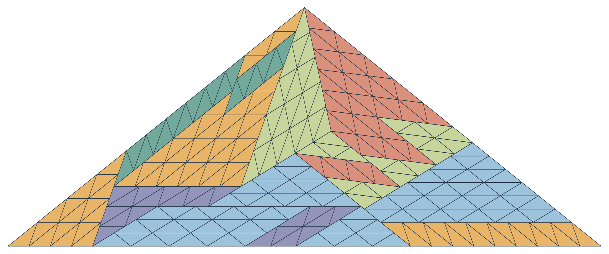

# A (90,90,140) triangle tiled by 280 congruent (5,6,9) triangles

The 280 coordinate rows give an exact dissection. The entire square class has the following criterion for positive integers \(m\).

$$
G(70m^2)\quad\Longleftrightarrow\quad m\ge2.
$$

## Coordinates and verification

In `tiling_280.csv` each row gives three counterclockwise vertices `x1,y1,x2,y2,x3,y3`. The pair \((x,y)\) encodes the Euclidean point \((x/81,\sqrt{2}\,y/81)\). The board vertices in integer coordinates are \((0,0),(11340,0),(5670,3240)\). An integer displacement \((u,v)\) has squared Euclidean length \((u^2+2v^2)/81^2\). The six colors in the figure correspond to the six directions of the shortest tile edge.

Run `python3 verify.py` in this directory. This standard-library Python verifier checks all 280 distinct triangles for containment and side lengths, then tests each of the 39,060 pairs for disjoint open interiors using supporting edge lines. The sum of their signed determinants equals the board determinant, 36,741,600. These conditions prove coverage, since any missed interior point has an open neighborhood of positive area outside this finite union of closed tiles. The boundary follows by closure. A separate check in the same program cancels oriented edges on every supporting line, including partial side matches at T-junctions.

An independent computational implementation, `python3 verify_slices.py`, checks coverage by vertical slices in all 208 open slabs between consecutive vertex abscissae. Both programs read the same coordinate file. Its SHA-256 digest is `d2d57d4ba326564f8002c7aecaee2ecb4d5c5610e42c36dbc89ce54fb6835ae9`.

## Why this settles the square class

For \(m=1\), 70 is absent from the exhaustive list of admissible counts through 200 in Bonfioli's Theorem 1.3. The coordinate certificate establishes \(m=2\). For \(m\ge3\), take \((u,v)=(2,3)\), with \(b=v^2-u^2=5\) and \(Q=2v^2-u^2=14\). Bonfioli's notch theorem constructs \(\theta_t(2,3)\) for every integer \(t\ge7\). Paliy's gluing attaches a \(5m\)-fold tile triangle to \(\theta_{3m}(2,3)\), producing the alpha-isosceles triangle at scale \(m\). These two parts contain \(5(3m)^2\) and \((5m)^2\) tiles, respectively. [Bonfioli, Theorem 1.3](https://github.com/ElVec1o/erdos634_primes_and_N200/blob/752005605ca4e607d2a08f57bdc2445dd5558dbb/README.md#L101-L108) · [Bonfioli, notch theorem and threshold for (2,3)](https://github.com/ElVec1o/erdos634_primes_and_N200/blob/752005605ca4e607d2a08f57bdc2445dd5558dbb/paper/erdos634_v6_main.tex#L389-L403) · [Paliy, theta-to-alpha construction](https://github.com/DenisUkranian/erdos-634-tilings/blob/0f7935b71fd958bd764bccf079e1e70bc68ce351/docs/universal-rational-scales.md#L259-L261).

The explicit witness was found in this computational search using the finite set of candidate positions from Denis Paliy's project. Both coordinate verifiers stand on their own. The witness has not undergone independent scholarly peer review. [Paliy project, earlier finite placement reduction](https://github.com/DenisUkranian/erdos-634-tilings/blob/c18097f56242dd43aebb11e54f5a56cf6eeca49b/research/2026-11-19/next/alpha280mesh/README.md).
