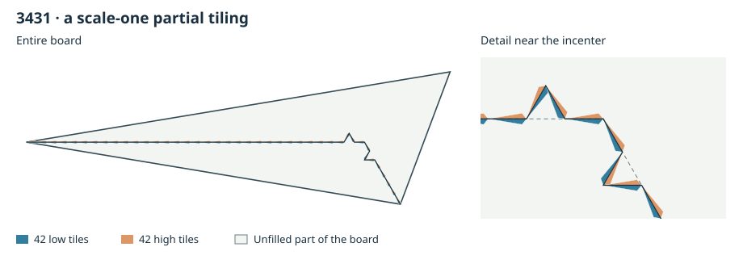

# Products of two primes in the unit F2 triangle

20 November 2026. Research by Denis Paliy with ChatGPT assistance.
The mixed-residue prime-pair reduction leaves the problem of filling a
specific triangle by a specified tile. If $p=a+2b$, $q=2a+b$ and
$c^2=a^2+ab+b^2$ with $a>b$ odd and primitive, the outer sides are
$ap,bq,c^2$ and the area requires exactly $pq$ tiles. The cases
$3431=47\cdot73$ and $5063=61\cdot83$ remain undecided at this scale.

The [common obstruction continuation](continuation/common-obstruction/README.md)
adds unrestricted joint-phase and terminal-node restrictions, exact bounds
under additional native-mesh hypotheses, and local geometric controls
showing why stronger conclusions still require a global argument. Neither
original count is decided by these results.

The [physical charge transport continuation](continuation/charge-transport/README.md)
connects phase charges to real contact boundaries, proves a positive cost
even for balanced cuts, and localizes the conditional minimum odd population.
An exact abstract axis-flow countermodel identifies why the retained count
and flow constraints alone still do not decide either target.

[New results for prime products and their triples](continuation/README.md) include the exact criterion for simultaneous tileability of pq and 3pq, partial pentagon constructions, and obstructions to completing them. The seven unit prime products listed below remain undecided.

**Restrictions on the whole board.** Group tiles by the direction
of their two shorter edges modulo $60^\circ$. The base has height 0
and the two other sides have height 2. There is at most one gap among
the occupied heights. If height 1 occurs it requires at least $2c$
tiles, for every primitive odd parameter denominator $v$. If it is
absent the tiling splits into exactly $c^2$ low and $c^2+3ab$ high
tiles along one simple lattice path. Every edge of that path determines
one actual tile on each bank. These conclusions allow arbitrary
reflections and T-junctions and apply to tilings which bypass the two
reflected corners. [Height gaps](FULL_BOARD.md) · [Line-count proof](LINE_COUNTS.md)
· [Path, graph and partial tilings](INTERFACE.md).

| Product | Tile | Minimum at height 1 if present | Low / high tiles if absent | Compulsory bisector length if absent | Tiles in the verified detour patch |
|---:|---|---:|---:|---:|---:|
| 3431 | (33, 7, 37) | 74 | 1369 / 2062 | 185 | [84 coordinates](controls/interface_3431.json) |
| 5063 | (35, 13, 43) | 86 | 1849 / 3214 | 129 | [100 coordinates](controls/interface_5063.json) |



For every remaining odd shape, there is a nonshortest interface patch
with $2(a+b+2)$ actual tiles and the required areas on its two sides.
Finishing those sides is a further geometric requirement. Another
possible route starts with tiles at height 1. The known unit
143 example has 105 such tiles and 38 at height 2.

**Other tested constructions.** The [unit staircase](staircase/SHARP_STAIRCASE.md)
has an exact parameter range for that construction.
The seven mixed-residue prime products outside its range through
one million are 3431, 5063, 19367, 60023, 64367, 271151 and 641591.
The [arithmetic enumeration](census_f2.py) checks this finite list
directly for the F2 branch. Inside the reflected-corner quadrilateral
$Q$, a filling outside the staircase needs at least two distinct tile
orientations having two or more axes absent from its boundary.
[Quadrilateral proof](corners/PROOF.md) · [Straight-length test](corners/BOUNDARY.md).
Searching 30 explicitly tiled larger boards yielded no intact unit copy.
[Extraction method and positive controls](EXTRACTION.md).

## Reproduce

Run these commands from this directory with standard Python 3, with
assertions enabled. The [outputs](REPLAY.txt) give the arithmetic and
geometric checks separately.

```sh
python3 verify_full_board.py
python3 verify_line_counts.py
python3 interface_graph.py
python3 census_f2.py
python3 scan_patches.py
python3 sweep_dilations.py
python3 corners/check.py
python3 corners/cycles.py
python3 corners/boundary.py
python3 staircase/arithmetic.py
python3 staircase/check_staircase.py
```

The source 143 configuration is attributed to Herdt. Bonfioli's
coordinates and later use of grid constructions are credited in the
[construction note](staircase/STAIRCASE.md). The height-cut and
single-height boundary results used here are earlier project results,
linked in the proofs. The new full-board results are research claims
with finite exact replays. Independent peer review and a Lean proof of
these claims are still outstanding.
