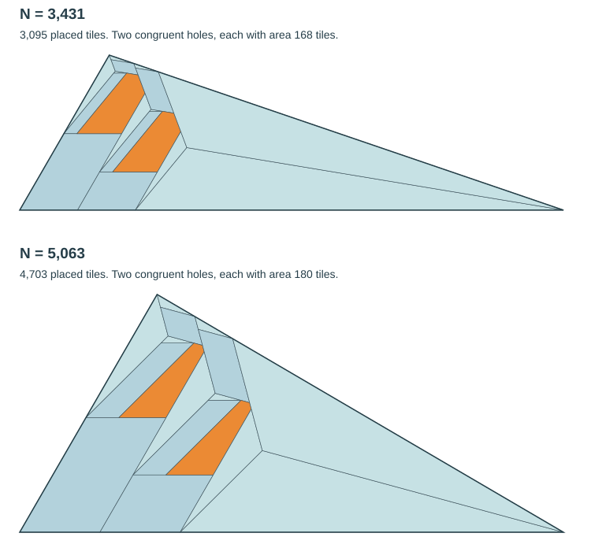

# Prime products, their triples, and the unit F2 triangle

Research record, 20 November 2026. Denis Paliy project, with ChatGPT assistance. This continues the [prime-product reduction](../README.md). The geometric framework and individual certificates used as inputs are identified in each proof. The new results have internal mathematical and computational checks. Independent refereeing and formal verification of the new claims are outstanding.

## Prime partners without a bound on the second factor

Each prime greater than three has at most one possible mixed-residue partner. An exact reconstruction and two independent enumerations find 312 pairs outside the unit staircase with at least one prime at most one million. The original tiling question has a complete answer for every prime partner of 1031. The mixed decisions at 3431 and 5063 remain open. [Partner theorem, classifier and census](partners/README.md) · [Full 1031 row](partners/PALIY_PATHS.md).

For every prime $P$ congruent to 19 modulo 2184, the only prime $Q$ for which $PQ$ tiles is $Q=P$. [Proof from the older geometric overlist](partners/ISOLATED_ROWS.md). On every primitive F2 board the straight seam issuing from the 60-degree corner cannot meet either other corner seam at unit scale. Walks with arbitrarily many turns are subject to a related restriction on their edge directions. [Corner seams](first-cuts/CORNER_RAYS.md) · [Paths between corners](first-cuts/CORNER_PATHS.md).

## Actual scale-one packings for the first two mixed pairs

The 3431 and 5063 boards admit saturated packings of 3423 and 5059 complete tiles, respectively. At 3431 any improvement must disturb the existing packing, and neither of its two pentagons can be tiled on its own. [Exact 3431 replay](packing/SATURATION.md). At 5063 the two residual hexagons each have area two tiles, yet their longest contained segment has length $1289/35<43$, below the largest tile side. Any full 5063 tiling would require at least ten placements outside the signed construction's list of 5071 positive placements. [Packings and replay](packing/README.md) · [Sharp bound on contained segments](packing/LONGEST_SEGMENT.md) · [Forbidden placement groups](packing/FORBIDDEN_PATTERNS.md).

## The common boundary in an explicitly tiled trapezoid

For every unit F2 board, attaching one tiled parallelogram along its full side gives a convex trapezoid with an ordinary tiling by the same tile. At 3431 the padding and trapezoid contain 5840 and 9271 tiles. At 5063 their counts are 7968 and 13031. Realizing the indicated edge across the padded tiling is equivalent to the original unit question. [Construction, diagram and exact checker](signed/PADDING.md). The associated [signed scale spectrum](signed/GCD_SPECTRUM.md) is closed under greatest common divisors.

For every mixed pair outside the staircase, the first straight cut has at most six arithmetically possible placements at denominator one and seven at higher denominators. The seventh placement passes the length tests for all those higher-denominator parameters. [Classification of cuts](first-cuts/PROOF.md). The scale-two equilateral corner admits a proper partition into tiled convex polygons with sides in three 60-degree directions precisely when the scale-one equilateral triangle tiles. [Convex partition theorem](cuts/AXIS_POLYGONS.md). For 5063 an exact two-height certificate eliminates 27 small terminal polygons under that orientation restriction. [Certificate and replay](cuts/f1_624_two_heights/PROOF.md).

## Straight cuts on the 3431 and 5063 boards

Any maximal sequence of straight cuts through the tile edges of a hypothetical 3431 tiling leaves at least one convex piece of 924, 2111, 2311 or 3431 tiles among the terminal pieces. The fixed (231,259,280) triangle cannot be filled by 280 copies of (33,7,37), as verified in all three possible orientation bands. For 5063 a terminal piece has at least 455 tiles. A tiling with all terminal pieces below 1820 would imply a tiling of the (455,559,624) triangle by 624 copies of (35,13,43). Both original scale-one decisions remain open. [Cut theorem and small certificates](cuts/README.md) · [Fixed-tile exclusion at 280](cuts/f1_280/PROOF.md).

## Direct decisions for prime products

For 3<p<q≤7p/4 the original tiling question has the classical, Paliy or F2 arithmetic answer except at six listed products. For q≤19p/10 there are 56 such staircase exceptions, and for q≤199p/100 there are 18,789. The last of these intervals gives a complete rule for every pair with smaller prime exceeding 7,952,292,373. These are unrestricted results in ratio intervals, with no ceiling on the product. [All four intervals, the criterion and the exact exception generator](counting/MIXED_RATIO.md).

## Two counts with the same prime factors

For every pair of primes p,q, **both pq and 3pq tile if and only if p=q or the pair is 2 and 3**. A single elementary factorization rules out the simultaneous F2 and Paliy conditions. It even works when the smaller F2 factor is a power of a prime greater than three. As a positive check outside the hypotheses, both 132,542,399 and its triple are explicitly constructible. [Theorem and proof](SIMULTANEOUS.md) · [arithmetic replay](check_simultaneous.py).

There is also a decision for 3pq alone outside at most one larger prime partner per smaller prime p>3. With 3<p<q<2p the exact positive test is 3p<2q and both 3p−q and 3(2p−q) are squares. With q>2p there is the positive count 345. All other possibilities require q=(p²+18p+9)/4 if p is 1 modulo 4, or q=(p²+18p−27)/4 if p is 3 modulo 4. The number 777 lies on the second numerical curve with a different candidate shape. This latter classification uses two additional moving-bank manuscript arguments. At 3pq≤3,000,000 there are 139,667 inputs with 3<p<q, nine certified positives, 139,639 negatives and 19 candidates. [3pq classification](counting/ALL_THREE_P_Q.md) · [equal residues](counting/THREE_PRIME_EXCLUSION.md) · [F2 triples](counting/F2_TRIPLES.md).

## A restriction on every tiling of a residual unit board

With primitive odd F2 sides $a\ge2b$ and $c^2=a^2+ab+b^2$, at least $4c-2(a-b)+1$ tiles have no half-turn mate along their entire long edge. Every remaining mixed semiprime parameter beyond the unit staircase satisfies the ratio hypothesis. The bounds are 97 for 3431, 129 for 5063 and 1,177 for 641591. The proof applies to the original triangle with freely oriented tiles and T-junctions. The seven board questions below remain open. [Theorem and proof](cycles/LONG_EDGE_PAIRS.md) · [integer replay](cycles/check_long_pairs.py).

On every odd F2 board a balanced lattice outline of area $2c^2$ tile-areas fits geometrically. At the required area the fewest reflex vertices for 5063 is exactly two. The range for 3431 is two to four. A row obstruction explains which parallelogram fillings fail even after allowing different directions. [Outlines and sharp capacities](cycles/CYCLES.md) · [universal construction](cycles/BOUNDARY_WITNESSES.md) · [row obstruction](cycles/PAIRING.md).

## What changed on the seven original unit boards

Each odd residual F2 triangle now has two explicit partial dissections. One leaves a single convex pentagon and covers at least 3225/3431 of the target by complete tiles. A second leaves two translates of a pentagon of less than one quarter of the area of the older quadrilateral Q. The percentages refer to the covered area. The seven existence questions below remain open.

| Unit count | Earlier Q area | Area of each of two holes | Single-hole area | Tiles placed in the single-hole construction |
|---:|---:|---:|---:|---:|
| 3,431 | 693 | 168 | 206 | 3,225 |
| 5,063 | 1,365 | 180 | 250 | 4,813 |
| 19,367 | 2,805 | 693 | 874 | 18,493 |
| 60,023 | 10,725 | 2,073 | 2,734 | 57,289 |
| 64,367 | 7,245 | 1,800 | 2,302 | 62,065 |
| 271,151 | 35,853 | 7,620 | 10,042 | 261,109 |
| 641,591 | 43,173 | 10,773 | 14,026 | 627,565 |

Exact searches exclude the specified pentagons of areas 168, 180, 206 and 250, as well as two different 233-tile pentagons on the 3431 board. Thus the initial two-hole construction cannot be completed on either small control, and the one-hole construction cannot be completed on either 3431 or 5063. The 250 pentagon has a complete 31-part search from the empty region, totalling 5,331,660 node visits. The shorter quadrilateral attempts with 105, 117, 147 and 195 tiles are also excluded. These results allow reflections and T-junctions inside each prescribed hole. An asymmetric 248-tile hexagon on the 3431 board also has an exhaustive exclusion. Every partial dissection in the [clipped hexagon family](patches/HEXAGONS.md) forces a new edge direction through a boundary edge-length equation. Other tilings of the original triangle can cross any of the selected boundaries. On the entire two-orientation notch family, the exact threshold is t≥a+c⌈k/a⌉ for arbitrary integer outer size t. [Two-orientation theorem](notches/TWO_ORIENTATION_NOTCH.md) · [Enumeration at the first mixed scales](notches/TWO_ORIENTATION_GRIDS.md). [Universal construction](patches/PENTAGONS.md) · [quarter bound](patches/QUARTER.md) · [exact pentagon searches](patches/decision/PENTAGON_SWEEP.md) · [quadrilateral searches](notches/NOTCH_ENUMERATION.md).

For an arbitrary tiling of a residual unit board, its upper interface of whole long tile edges has just one shortest possibility. A path of length a+b is the canonical path, enclosing a triangle tiled by c² tiles. Every other such upper path has at least a+b+2 edges. This corrects a possible interpretation of the displacement-only bounds. In particular a previously verified 47-step partial path at 5063 cannot belong to a full tiling. The allowable lengths start at 40 or at least 42 for 3431, and 48 or at least 50 for 5063. For odd lengths alone the [necessary minima](paths/ODD_UPPER_MINIMUM.md) strengthen to 49 and 57, respectively. [Current and area proof](paths/UPPER_RIGIDITY.md) · [whole-board paths](paths/TWO_PATHS.md) · [height population bounds](paths/SUPERLINEAR.md) · [vertex lattice](paths/VERTEX_LATTICE.md).

## Further verified results

* In the odd squarefree sector N=23 modulo 24 whose prime divisors are all 1 or 11 modulo 12, the number of actual tile counts up to X is asymptotic to approximately 0.02636√X. The unit staircase alone has the same leading term. Among all squarefree integers, the number of actual tile counts outside the sums of two squares has order exactly √X. For example, exactly 5/16 of these actual tile counts are divisible by 11 in the limit. The [local divisor theorem](LOCAL_FACTORS.md) also allows finite lists of prescribed primes on either F2 factor. The sector allows any number of prime factors. [Global counting theorem](SPLIT_SECTOR.md) · [binary quartic and its local factors](F2_MASS.md).
* Complete scale-two certificates give 77,468 and 257,468 tiles for the doubled triangles belonging to 19,367 and 64,367. The independent verifier checks metrics, areas, containment and disjoint block interiors. No intact unit board was found in the eight new doubled test layouts. [Dilation construction](dilations/SCALE_TWO.md) · [generator and verification](dilations/double_exceptional.py) · [extraction](dilations/extract.py).

[Reproduction commands and outputs](REPLAY.md).
