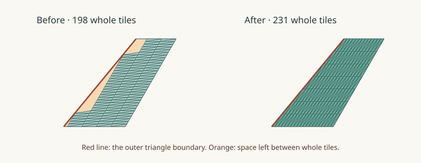

# A boundary switch adds exactly $a$ whole tiles

Let $a>b>0$ be coprime odd integers and $c^2=a^2+ab+b^2$. Write $p=a+2b$, $q=2a+b$, $N=pq$. The board $T$ has vertices $0$, $H=bq$, and $V\rho=ap\rho$, where $\rho=e^{i\pi/3}$. Write $w=a+b$, $z=(a+b\rho)/c$. There is a specified half-rhombus on the actual side of length $c^2$ and a local change with the following properties.

* The initial half-rhombus packing has $ab-a$ tiles. Its replacement has $ab$ tiles and fills the half-rhombus exactly. The replacement gives a continuous tiled boundary along the centered segment of length $bc$ on the side of length $c^2$.
* Start with every tile of the specified initial plane grid that lies in the board. The change preserves every placed tile outside the half-rhombus and adds exactly $a$ complete tiles to the total. The same change works with any other exterior packing that does not occupy the half-rhombus interior and with the same prescribed initial packing inside.
* Reflections, partial edge contacts and T-junctions are permitted. A packing with other tiles crossing the proposed patch boundary has to clear those crossings first.

### Placement and the two fillings

Take $e=\rho^2z=(-w,a)/c$ and $f=\rho z=(-b,w)/c$ in axial coordinates. The rhombus $R$ has side vectors $ab e,ab f$ and center $M=(H/2,V/2)$. Its half-widths in the two axial coordinates are $abp/(2c)$ and $abq/(2c)$. They are strictly below $H/2$ and $V/2$, since $ap<cq$ and $bq<ap<cp$. Thus $R$ lies in the open positive quadrant, and its sole clipping by $T$ is the board-side line through $M$. This produces exactly two halves. At the rhombus vertex $O=M-ab(e+f)/2$, both coordinates have denominator dividing $c$: the numerator for either coordinate over $2c$ is even because $a,b,c,p,q$ are odd.

Use cell vectors $ae,bf$ in the old grid and $be,af$ in the new one. In each cell take the positive sum diagonal. Its length is $c$ in both grids because the angle between $e$ and $f$ is 60 degrees. Direct multiplication gives
$$
 ae+bf=c\rho^2,\qquad be+af=c\rho z^2,qquad V\rho-H=c^2\rho z^2 .
$$
The outer side therefore runs exactly in the new diagonal direction. In new cell coordinates the whole rhombus has dimensions $a$ by $b$. The center has coordinates $(a/2,b/2)$ with integral difference. Its slope-one diagonal is a union of whole tile edges and traverses exactly $b$ diagonal steps. By central symmetry each half of the rhombus has an ordinary tiling by $ab$ tiles.

### Counting the old tiles cut by the side

In old coordinates $O+Xae+Ybf$, the rhombus is $[0,b]\times[0,a]$. The same line now runs from $Y=0$ to $Y=a$ with $dX/dY=b^2/a^2<1$ and center $(b/2,a/2)$. Its horizontal span is $b^2/a<b$, and its equation is
$$
 a^2X-b^2Y=ab(a-b)/2 .
$$
No old grid vertex lies on this segment: at an integral solution reduction modulo $b$ forces $b\mid X$, whereas the entire segment has $0<X<b$.

Inside each open horizontal unit row the segment crosses exactly one interior line from the two families $X\in\mathbb Z$ and $X-Y\in\mathbb Z$. Indeed, starting at $Y=j$, let $t$ be the fractional part of $X$ there and put $d=b^2/a^2$. If $t+d>1$ it crosses one vertical line and no diagonal. If $t+d<1$ it crosses one diagonal and no vertical line. Equality is excluded by the vertex argument. Thus exactly two triangle interiors per row are crossed, or $2a$ in total. The half-turn about $M$ pairs all remaining triangles across the line. Exactly $(2ab-2a)/2=ab-a$ whole old tiles lie on the board side.

The full rhombus is a union of grid cells in both tessellations. In particular, every retained old tile outside it has disjoint interior from it, including in cells close to the outer side. This proves the claimed local gain.

### Exact control examples

| Board | Old tiles inside the patch | New | Total in initial clipped plane grid | After the single switch |
|---:|---:|---:|---:|---:|
| 3431 | 198 | 231 | 2949 | 2982 |
| 5063 | 420 | 455 | 4659 | 4694 |

The initial plane grid here is chosen to exhibit the directional gain at the physical board boundary. The higher-count packings in the project use different placements.

The whole plane can also be divided into translates of $R$ by its two side vectors. In each rhombus choose whichever of the two regular grids retains more whole tiles inside $T$. These choices are mutually compatible because no original or new tile crosses a rhombus boundary. This gives 3261 for 3431 and 4847 for 5063. The [exact enumeration](check_boundary_gain.py) tests the three board half-planes for each triangle and sums per-rhombus counts. This last count is optimal for the fixed phase and the choice of one grid per rhombus. Mixtures within the same rhombus and different placements inside the entire board remain possible.

The rule changes the occupied area at an actual outer side. Its applicability to these explicit packings does not give compatibility with an independently chosen high-count packing or a complete tiling of either board.
