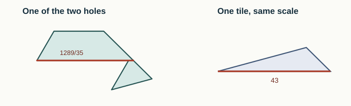

# The longest straight segment in the 5063 residual hexagon

In the axial basis $1,\rho=e^{i\pi/3}$, consider the hexagon H in cyclic order
$$
 (0,0),\quad (-19,0),\quad (-19,-13),\quad (16,-13),\quad
 (16,-26),\quad (1248/43,-910/43).
$$
The longest segment contained in H has length **1289/35**, attained by
$$
 (-19,-13)\ \text{ to }\ (624/35,-13).
$$
In particular H cannot receive even one triangle of sides 13, 35 and 43 in any position or orientation. The doubled axial area of H is 910; the doubled axial tile area is 455.

## A short exclusion by three bounds

Put $r=(16,-13)$ and let K be the convex hull of H. Its vertices, in boundary order, are precisely the five vertices in the displayed list other than r. Removing the open quadrant $x<16$, $y<-13$ from K gives H. In fact the portion of the quadrant inside K cuts off exactly the triangular notch bounded by the edges incident to r and the hull chord from $(-19,-13)$ to $(16,-26)$.

Any segment in H is convex and avoids that open quadrant, so it can be separated from the quadrant by a line through r. The nonzero separating covector has both coefficients nonnegative because the quadrant is unbounded in the negative directions. Normalize it to $(s,1-s)$ and set
$$
 C(s)=K\cap\{s(x-16)+(1-s)(y+13)\ge0\},\qquad 0\le s\le1.
$$
The entire segment is contained in C(s). Conversely C(s) is a convex subset of H. If $l\le s\le h$, linearity in s gives $C(s)\subseteq C(l)\cup C(h)$. A bound on the diameter of the union is the largest distance between vertices in its two polygons, since distances are convex in either variable. The squared axial distance of two points whose difference is $(x,y)$ is $x^2+xy+y^2$.

| Parameter interval | Squared diameter of the union of the two endpoint caps |
| --- | ---: |
| $[0,1/3]$ | $188257/121$ |
| $[1/3,2/3]$ | $49228/43$ |
| $[2/3,1]$ | $256$ |

Each entry is less than $43^2$. These three checks already exclude any complete tile. The [short rational checker](diameter.py) clips each of the five edges by the two boundary lines and compares squared distances.

## Exact diameter of the longest contained segment

For sharpness consider all separator lines through r. Their angular order agrees up to reversal with their order in s, since the normals are positive linear combinations of two independent coordinate covectors. Between two successive positions where the line meets an original hull vertex, each vertex of C(s) either stays at an original hull vertex or moves monotonically along a fixed hull edge. There are only two moving vertices, the endpoints of the separator chord. These facts hold because r is strictly inside K.

For a fixed and a moving vertex, the largest distance on the interval occurs at an end, by convexity of the norm along the fixed edge. For the two moving vertices, the chord passes through r. Measure its physical direction by the Euclidean angle $\theta$. The distance from r to either endpoint is $d/\cos(\theta-\phi)$ for a fixed perpendicular distance d from r to that hull edge's line and a fixed directed normal angle $\phi$ (including the opposite-ray adjustment for the second endpoint). The cosine is positive on the interval. The secant is convex there, since its second derivative is $\sec x\,(\tan^2x+\sec^2x)>0$. Their sum, the chord length, consequently also has its maximum at one of the two ends. Continuity includes lines through hull vertices. Thus the greatest diameter over all caps occurs in the following five caps.

| s | Squared cap diameter |
| --- | ---: |
| $0$ | $1661521/1225$ |
| $13/48$ | $415249275/361201$ |
| $351/911$ | $27376300/31347$ |
| $13/29$ | $676$ |
| $1$ | $256$ |

Indeed these interior parameters are exactly those for which the line passes through a vertex of K. The greatest entry is $(1289/35)^2$ at $s=0$. Both endpoints of the stated attaining segment belong to C(0), so the bound is attained. Run `python3 diameter.py` with assertions enabled to check both tables.
