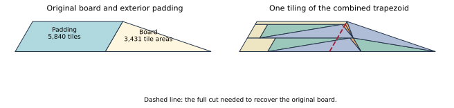

# A single parallelogram makes every unit F2 triangle tileable

Let $a\ge b>0$ and $c$ be integers with $c^2=a^2+ab+b^2$. Write $p=a+2b$, $q=2a+b$. The unit F2 triangle $T$ has sides $ap,bq,c^2$. The following construction works for every such triple, independent of primality or the unit staircase.

**Theorem.** Attach a parallelogram $P$ with sides $a(a+b)$ and $bq$ along the **entire** side $bq$ of $T$, on the outside. Its other sides are parallel to the side $ap$. Both $P$ and the convex trapezoid $U=T\cup P$ admit ordinary tilings by the specified $(a,b,c)$ tile. The interiors of $P$ and $T$ are disjoint. The counts are
$$
 \# P=2(a+b)q,\qquad \# U=pq+2(a+b)q .
$$
Consequently the original question for this pair is equivalent to whether $U$ admits a tiling in which the specified segment $P\cap T$ is contained in the union of tile edges. This extra condition allows any number of T-junctions on either bank. The two tilings just constructed need not agree on the padding.

| Original board | Padding width and side | Tiles in padding alone | Tiles in the full trapezoid |
|---:|---|---:|---:|
| 3431 | $1320,511$ | 5840 | 9271 |
| 5063 | $1680,1079$ | 7968 | 13031 |

## Construction

Use the basis $1,\rho$, where $\rho=e^{i\pi/3}$. Put $L=ab$, $K=a^2+b^2$, $W=a(a+b)$, $A=ap$, $B=bq$. The board has corners $(0,0),(A,0),(0,B)$. Take $P=[-W,0]\times[0,B]$ in these axial coordinates. The vertices of $U$ are $(-W,0),(A,0),(0,B),(-W,B)$ in counterclockwise order. A parallelogram of width a multiple of $a$ and height a multiple of $b$ uses rectangular arrays of axial $a$-by-$b$ cells. Splitting each cell from its southwest corner to its northeast corner makes two copies of the tile because that diagonal has squared Euclidean length $a^2+ab+b^2$. Interchanging $a,b$ also works. This gives the stated padding count.

Inside $T$ remove the equilateral corner $E$ with vertices $(0,0),(2L,0),(0,2L)$. Its complement is tiled by the three standard grids at scales $a,b,c$ of the [incenter partition](../cuts/README.md). Their common vertex is $(L,L)$. Combine $E$ with the lower part $[-W,0]\times[0,2L]$ of the padding. The result splits at $y=L$ into two ideal trapezoids with leg $L$ and upper widths $W+L,W$. At $y=jL$, $j=0,1$, the right-hand part is the [basic Zhang trapezoid](https://arxiv.org/pdf/2512.22696), whose short base is $K$ and whose three grid scales are again $a,b,c$. One explicit model has corners $(0,0),(K+L,0),(K,L),(0,L)$ and division point $(a^2,L)$ on its upper edge. Joining that point to both lower corners gives the three grids. Translate this model by $((1-j)L-K,jL)$.

The remaining left strips have respective widths $W+L-K=b(2a-b)$ and $W-K=b(a-b)$. Both are multiples of $b$ and their height $L$ is a multiple of $a$. Tile them by the reversed cell orientation. The rest of $P$ is a top strip of height $B-2L=b^2$ and width $W$, covered by the first cell orientation. All interfaces now match as geometric regions. Exact checks of lengths, areas, pairwise disjoint interiors and subdivision counts are in [verify_padding.py](verify_padding.py).

Giving the tiling of $U$ sign $+1$ and the tiling of $P$ sign $-1$ proves the indicator identity $\mathbf 1_T=\mathbf 1_U-\mathbf 1_P$ up to boundaries. Thus additive colorings on all rigidly placed tiles cannot rule out these unit boards. The construction is stronger than a signed identity in one respect: all negative tiles form a single disjoint exterior parallelogram admitting its own ordinary grid.

Run `python3 verify_padding.py` using the Python standard library. The two controls and 2455 parameter pairs are checked. The proof above covers the full parameter range. The [three-scale argument](SIGNED_TILINGS.md) gives a signed identity even for triangular targets outside this geometry.

For odd coprime $a>b$, the displayed width is the least one in this particular two-band construction when the top band's width beyond the basic trapezoid must be $ma+nb$ with $m,n\ge0$. Indeed, an independently tileable padding of integral width $W'$ must have integer count $2W'B/(ab)=2W'q/a$. Coprimality and odd $a$ imply $a\mid W'$. The requirement $W'-K=ma+nb$ then gives $n\equiv-b\pmod a$. Thus $W'\ge K+b(a-b)=a(a+b)$. Other tilings of the padded trapezoid can use different widths or cross the two bands.

In particular, a tiling of the padded 3431 trapezoid that preserves the seam **and** preserves the horizontal subdivision of the equilateral corner at $y=L$ would tile the upper triangle of side 231. The [fixed-tile certificate](../../../../2026-11-19/nov19/equilateral231/cert/README.md) excludes it. Any attempt to recover this board by keeping its corner and the seam must allow the tiles to cross that band division.
