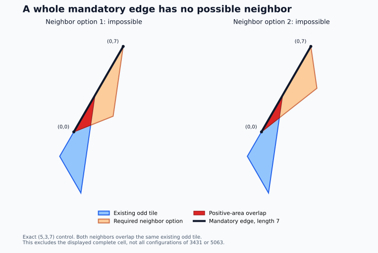

# The mandatory long bank of a complete odd packing

21 November 2026. **3431 and 5063 remain open.** The theorem below is
valid at every odd population and every finite height range in the established
placement framework. It retains actual longitudinal coordinates, whole
neighboring triangles, and the population they consume.

The earlier cylinder model cancels the endpoints of a length-`c` edge by
identifying positions separated by `c`. Here that identification is inverted.
Once the complete odd packing is fixed, the noncancelling long edges of the
even tiles are uniquely determined. Their exact physical completion has only
two choices per edge and can be checked by a finite 2-SAT instance.

This is an elimination theorem conditional on a specified odd packing. It
does not enumerate every possible odd packing, and passing its necessary
test does not supply a complete tiling.

## 1. Setting and notation

Let `a>b>0`, `c²=a²+ab+b²`, and use axial coordinates in
`R=Z[rho]`, where `rho=exp(i*pi/3)` and `z=(a+b*rho)/c`.
The tile convention is

\[
u=q-a z^h\rho^j,\qquad w=q+b z^h\rho^{j+s},
\qquad \varepsilon=s(-1)^j.
\]

The short edges have direction height `h`; the long edge has height
`h+1` or `h-1`. On the standard F2 board, every exterior side has even
direction height. Therefore at each odd direction height, the full boundary
equation contains precisely the short sides of odd tiles and the long sides
of even tiles. T-junctions are allowed throughout.

Let `O` be the **complete** odd subfamily of a hypothetical tiling. It is
a finite set of actual, whole, contained triangles with disjoint interiors.
Write `n_o=|O|`, `G_o=sum epsilon`, and `d=a-b`. On the standard target
boards, `G_o=-c` and the complete even charge is `G_e=-d`.

On a fixed actual supporting line choose an oriented unit direction `e`.
The scalar endpoint current of the odd short sides is the finite integer
measure `J(t)`: an oriented edge contributes `+1` at its start and `-1`
at its end. A long segment starting at `t` and ending at `t+c` has
endpoint vector `delta_t-delta_(t+c)`.

## 2. Unique reconstruction of net long edges

Partition the finitely many endpoint positions into orbits modulo `cZ`.
Fix one such orbit, write its positions as `r+kc`, and let `J_k` be the
endpoint coefficients. A finitely supported sequence of signed long-segment
coefficients `b_k` must satisfy

\[
J_k+b_k-b_{k-1}=0.
\tag{1}
\]

It exists if and only if `sum_k J_k=0`, exactly the actual-line cylinder
equation. If it exists it is unique:

\[
\boxed{b_k=-\sum_{i\le k}J_i.}
\tag{2}
\]

The sum starts before the first nonzero endpoint. After the last endpoint
it is zero. A second finitely supported solution would have constant
difference on the entire doubly infinite orbit, and hence zero difference.

This argument also shows completeness: long edges in an orbit containing
no odd endpoint have net coefficient zero. They cannot change (2). No
guessed coordinate window is involved.

**Rigid line capacity.** In any nonoverlapping completion:

\[
|b_k|\le1,
\tag{3}
\]

and two reconstructed segments with the same orientation on the same line
cannot overlap in positive length, including segments belonging to different
`cZ` orbits. Their triangles would lie on the same side of the line and
overlap in an open neighborhood of any common interior edge point.

Oppositely oriented segments are not ruled out by this line test: they put
their triangles on opposite sides. Their actual triangle interiors must
still be checked below.

Call the resulting nonzero signed segments the **mandatory long bank**.
If (3) holds, let `B(O)` be their number. Before that check the algebraic
lower bound is `sum |b_k|`, with a capacity violation giving an immediate
obstruction.

## 3. Exactly two neighboring triangles per segment

An oriented segment `P -> Q` of length `c` must be the long side of a
triangle whose interior is on its left. There are exactly two possibilities:
assign distances `(a,b)` or `(b,a)` from the third vertex to `(P,Q)`.

Here is an exact rational construction, also used by the checker. Set
`v=Q-P` and

\[
H(x,y)=(-x-2y,\,2x+y).
\]

For `(r,s)=(a,b)` and `(b,a)` the two third vertices are

\[
T_{r,s}=P+
 \frac{r^2+c^2-s^2}{2c^2}v+
 \frac{ab}{2c^2}H(v).
\tag{4}
\]

Indeed `det(v,H(v))=2c²`, so the doubled axial area is `ab`;
the squared distances to `P,Q` are `r²,s²`. The positive perpendicular
coefficient selects the left side. Reflection and T-junctions introduce
no additional third-vertex positions for a whole long side.

For a negative coefficient reverse `P,Q` first. For an odd supporting
direction of height `h`, the two candidates have short heights `h-1`
and `h+1`, so both are even tiles. Formula (4) uses no restriction that
the entire tiling has only heights zero, one, and two.

Discard a candidate if it leaves the board or overlaps an odd tile.
For every two different mandatory segments, forbid each pair of candidates
whose triangle interiors overlap. Select exactly one candidate per segment.
With one Boolean variable for its two alternatives, all these restrictions
are clauses of size one or two.

**Bank completion theorem.** Subject to (2)--(3), this 2-SAT instance is
satisfiable if and only if the mandatory long bank can be realized by whole,
contained, mutually nonoverlapping even triangles disjoint from `O`.

The equivalence is only for the mandatory bank. The unfilled region and
the remaining even short-edge equations are additional requirements. The
solver exports implication paths in both directions between a choice and
its negation when it reports an obstruction; the checker rechecks every
edge of those paths.

## 4. Exact pairing and the global population identity

In an actual full tiling, subtract the mandatory even tiles. On every
actual line and every `cZ` orbit, the remaining signed long-edge coefficient
is zero. Nonoverlap permits at most one triangle on each side of a whole
long segment. Consequently all remaining even tiles pair on **identical
whole long sides**, one tile on each side.

These pairs need not be half-turn mates: their short heights may coincide
or differ by two. The assertion is equality of the common entire long
segment, proved by the unique finite-support inversion, not an assumption
of edge-to-edge tiling.

For a directed long side `c z^h rho^j`, both left-hand candidates in (4)
have sign `-(-1)^j`. The two candidates on the other side have the opposite
sign. Thus every unrecorded pair contains one positive and one negative
even tile. If the number of pairs is `P`, then

\[
\boxed{N=n_o+B(O)+2P,\qquad P\in\mathbb Z_{\ge0}.}
\tag{5}
\]

The signed character of the odd short sides is `dG_o`; the signed character
of the even long sides is `-cG_e`. Complete current cancellation gives

\[
\boxed{G_e=\frac{d}{c}G_o.}
\tag{6}
\]

In particular the mandatory bank already carries **all** even signed charge.
Its total charge is independent of which of the two candidates is chosen;
the pairs contribute zero. On the standard target boards it is `-d`.

The companion [paired population and height reserve](../global-geometry/PAIRED_BANK_RESERVE.md)
uses the exact nodes of both prime trees and the compulsory pairing in (5)
to obtain an explicit lower bound `P >= R(O,I)` for each bank assignment
`I`. It also retains the cost of moving even charge between heights. This
gives the global necessary inequality

\[
\boxed{
 N\ge n_o+B(O)+2\min_{I\in\mathcal B(O)}R(O,I),
}
\tag{7}
\]

where `mathcal B(O)` is the set of physically compatible bank assignments.
An empty set is an obstruction in its own right. This combines the whole
odd imbalance, actual contacts, nonoverlap, sign divisibility, and the finite
tile budget without a minimal-population or terminal-branch assumption.

## 5. What can be done with one complete cell

An ordinary odd Euclidean cell is a translate of `z^h R`. Its own short
endpoint current can be reconstructed separately. If an endpoint of another
cell lay in the same actual `c`-step orbit, their difference would belong
to `z^h R`, making them the same cell. Hence different cells cannot cancel
one another's reconstructed segment coefficient.

It is therefore valid to reject one **complete** cell for a line-capacity
failure, or for failure of its own necessary neighboring-bank 2-SAT test.
Different cells' mandatory banks must additionally be compatible with one
another. It is invalid to use this argument on an unfinished subset of a
cell: missing odd tiles in the same cell can change its endpoint current.

The pairing assertion (5) requires the complete **all-odd** family. For one
cell alone, the other cells' mandatory even tiles have not yet been removed
and need not form neutral pairs. We do not apply its paired reserve to a
single incomplete odd population.

## 6. Exact controls and the remaining target question

The replay checks a complete 143-tile tiling independently before extracting
its 105 odd tiles. Their mandatory bank has two even tiles; the other 36
even tiles pair into 18 opposite-sign common-long-side pairs. Both forced
bank choices occur in the supplied full tiling.

The new test rejects several exact rigid cylinder packings that the previous
model admitted:

| Complete proposed cell | Cylinder rows | Mandatory bank | Exact obstruction |
|---|---|---:|---|
| Separated unit-charge 13-tile control at `(5,3,7)` | zero | 522 segments | same-side segment overlaps |
| Compact unit-charge 13-tile control at `(5,3,7)` | zero | 32 segments | both whole neighboring choices forbidden at a mandatory edge |
| Separated balanced six-tile hexagon at either target | zero | 24 segments | incompatible neighboring triangle choices |
| Contained balanced 16-tile control at 5063 | zero | 86 segments | same-side segment overlaps |

These are specific configurations, not classifications of every packing
with the same population. A separate compact balanced six-tile patch has
zero full short endpoint current and therefore an empty mandatory bank.
It passes this necessary test. In particular the new method does not
justify deleting all six-tile cells or the remaining four-cell parameter
`x=40` at 5063.



The figure displays the exact compact `(5,3,7)` control. The blue triangle
is already present, the black segment is compulsory, and either possible
neighbor intersects the blue triangle in positive area. The rational
intersection and rejection are checked by the proof replay; the rendering
is illustrative. `draw_obstruction.py` regenerates the SVG and PNG with
Matplotlib and is not a dependency of the exact proof checks.

The new exact signed integer-image theorem also shows that no additional
linear congruence of the periodic endpoint/gate/sign model can settle these
targets. Nonnegative whole placements and their actual contact geometry
remain essential. [Arithmetic theorem and certificates](../arithmetic/README.md).

Neither all 3431 odd packings nor all 5063 odd packings have been excluded
by (7). Both original numbers, the 3431 population 111, the 5063 population
215, and the larger populations remain open.

## 7. Reproduction

```sh
python3 research/2026-11-21/semiprimes/integer-closure/long-banks/verify_long_banks.py
```

The implementation uses rational arithmetic and actual triangle separation;
no numerical solver or bounded coordinate search enters the theorem or
these selected certificate checks. The mathematical reduction is a written
proof with internal independent review, not a proof-assistant formalization.
