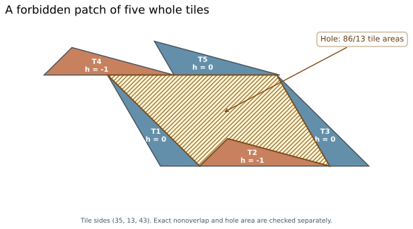

# Whole contacts, supported polygons, and unrestricted completion budgets

21 November 2026. **3431 and 5063 remain OPEN.** This continuation supplies
an unrestricted necessary-condition theorem, actual whole-tile contact
catalogues, exact geometric cuts, and an independently checkable finite
refutation pipeline. The target searches have not produced a refutation
or a complete tiling. The existing exclusion of the 5063 odd population
129, and its consequence `n_odd >= 215`, remain unchanged.

## Mathematical result

The [global contact theorem](GLOBAL_CONTACT_THEOREM.md) combines the actual
exterior, complete selected contact obligations, nonoverlap, signed
populations, and both prime valuation trees in one finite necessary model.
For any selected set of distinct whole tiles `S`,

\[
|S|+|-c-G_o(S)|+|-(a-b)-G_e(S)|\le N.
\]

The same argument localizes to a simple polygon supported by actual tile
sides. Its area and two boundary characters determine `n(P), G_e(P), G_o(P)`.
If its contacts force distinct interior owners `S_P`, then

\[
\boxed{|S_P|+|G_e(P)-g_e(S_P)|+|G_o(P)-g_o(S_P)|\le n(P).}
\]

The area and both charges must be integers, and population parity must
agree. The formula counts a shared physical owner once, even when it
serves several contacts. It can therefore exclude an integer-area hole
when the compulsory neighbors consume its remaining charge capacity.

The [weighted contact-budget theorem](population/contact_budget_theorem.md)
turns complete contact catalogues and nonoverlap cliques into exact lower
certificates for that compulsory minority population. It permits signed
rational contact weights and counts each owner once. In a genuine 143
control, five contacts across two T-junctions require the same minority
tile. The strengthened bound rises from one tile to three, matching the
actual integer-area hole; counting that owner five times is rejected.

The two phase trees are coupled through the same physical placements and
the same capacities at each height. Their costs are not added. The
existing no-empty-ancestor theorem gives at most **45** occupied or
required ordinary nodes in either tree for 3431, and **58** for 5063.
Per-node signed allocations strengthen those coarse bounds.

No height interval, odd population, periodic identification, or finite
placement box is assumed. Complete finite local catalogues justify every
queried equation. Unqueried placements remain possible.

## Whole tiles in every contact

An interior half-fan must have a selected whole through triangle on its
other bank. For a side of length `ell`, its strict through offset is an
integer from 1 to `ell-1`. There are six shape choices across the three
side lengths, giving at most 148 or 176 raw candidates at the targets.

For a whole selected side of length `L`, an opposite side of length `ell`
starts at integer offset `1-ell,...,L-1`. The catalogue has at most 370 or
434 raw candidates. Each open unit interval must have exactly one owner
on the opposite bank when the source tile is selected. Owner variables
are globally shared. T-junctions and reflections remain allowed.

The [owned-through controls](owned/README.md) identify a gap in the earlier
local predicate: a geometrically possible through line is not yet an
actual selected whole triangle. The new integrated model supplies that
triangle and charges its population once. Deleting an actual owner is
rejected in 114 local controls that the weaker predicate accepted; this
comparison is a local test, not a counterexample to an entire prior
global search.

The [whole-side model](whole-edges/README.md) also has an exact completion
criterion. If every selected side is closed, the exterior is covered,
and the contained whole tiles do not overlap, the selected union is the
entire board. Satisfying only the currently queried subset does not meet
this criterion.

## Supported holes and transferable forbidden patches

The [polygon checker](corner-tests/AREA_CYCLE_CUTS.md) atomizes actual
selected sides at all selected endpoints and T-contacts, then uses exact
simple boundary walks. It retains valid integer mixed-height cycles.
An exact 5063 partial packing of five nonoverlapping tiles encloses a hole
of **86/13 tile areas**. It cannot occur in a full tiling.



The [isometry seeds](corner-tests/ISOMETRY_SEEDS_5063.json) store this patch
and other compact obstructions as actual coordinates. Translation,
rotation, and reflection preserve their impossibility. Occurrence lookup
uses only existing contained whole placements; it inserts no missing
occurrence. Each learned no-good is expanded into its own actual polygon
and independently checked, without assuming any symmetry of the board.

In the recorded 74,399-column 5063 catalogue, the five-tile patch has 90
distinct occurrences, including 54 reflected occurrences. This is a
finite catalogue count, not an enumeration of all possible placements.
The [isometry audit](corner-tests/PATTERN_ISOMETRIES.md) checks labelled
vertices and every expanded boundary witness independently.
The final 3431 probe also discovered a contained nonoverlapping four-tile
support enclosing **34/7 tile areas** and added 50 isometric copies of
that obstruction. Both compact source patterns are retained for 3431.

## Exact controls and proof boundary

| Layer | Verification |
|---|---|
| Corner coverage | 128 complete roots per target; all remain available |
| Whole positive control | The genuine 143-tile tiling survives containment, nonoverlap, currents, fans, whole sides, and population budgets |
| T contacts | 38 strict T contacts share 29 whole through owners; one owner serves up to three contacts |
| Whole sides | 404 internal sides, 25 exterior sides, 2,002 unit-contact obligations in the positive control |
| Population strengthening | Exact 143 control survives unsigned and signed/shared-height allocation, solver rebuild, and geometric restart |
| Arithmetic projection | 13,333 exact signed parity-completion cases checked |
| Independent semantics | Metric reconstruction checks generated catalogues and every asserted constraint in the saved target snapshots |
| Finite proof trace | Separate Boolean/PB encoding and a standard-library RUP/RAT/DRAT checker; frozen positive and negative controls |

The [semantic audit](audit/README.md) separates the geometric theorem,
the finite formula, and an actual UNSAT trace. None of its successful
model audits is a target exclusion. No target refutation trace exists
in this package. A root-conditioned refutation would exclude only that
root; a complete branch proof must cover all 128 roots.

## Reproduce

The default replay is part of the repository-wide verification suite and
requires only ordinary Python with assertions enabled:

```sh
python3 research/2026-11-21/semiprimes/through-contact-closure/replay.py
```

Native solver integration is optional and requires `libz3`:

```sh
python3 research/2026-11-21/semiprimes/through-contact-closure/replay.py --with-solver
```

For an unrestricted search with all possible corner banks, signed
population capacities, and transferable polygon obstructions:

```sh
python3 research/2026-11-21/semiprimes/through-contact-closure/spatial/area_search.py \
  --allocation joint \
  --corner-bank-file research/2026-11-21/semiprimes/through-contact-closure/corners/ROOTS_3431.json \
  --isometry-seeds research/2026-11-21/semiprimes/through-contact-closure/corner-tests/ISOMETRY_SEEDS_3431.json \
  33 7 37 --out /tmp/whole-contact-3431 --grid-step 7

python3 research/2026-11-21/semiprimes/through-contact-closure/spatial/area_search.py \
  --allocation joint \
  --corner-bank-file research/2026-11-21/semiprimes/through-contact-closure/corners/ROOTS_5063.json \
  --isometry-seeds research/2026-11-21/semiprimes/through-contact-closure/corner-tests/ISOMETRY_SEEDS_5063.json \
  35 13 43 --out /tmp/whole-contact-5063 --grid-step 13
```

Querying all possible corner banks does not select a corner root. Every
bank obligation is conditional on its own tile variable.

The [checkpoint index](checkpoints/INDEX.json) preserves compact geometric
restart sources and exact hashes of the original full snapshots. The
driver regenerates their complete catalogues and current-pool budgets;
it does not import arbitrary clauses or previous root assumptions.
These compact files are not SAT formulas or refutation certificates.
See [checkpoint scope](checkpoints/README.md) and the adjacent saved status
files for resource limits and inconclusive outcomes.

## What remains

The missing result is either a complete geometric tiling or a verified
finite contradiction covering the unrestricted board. Enforcing whole
tiles and nonoverlap is necessary; it does not imply that the resulting
system is inconsistent. In particular, this continuation does not justify
the claim that adding a rigid-body condition automatically settles 3431.

The remaining 3431 odd population 111, the remaining 5063 odd population
215, and all larger allowed odd populations retain their prior open
status. Stronger necessary conditions and solver timeouts do not change
that status.
